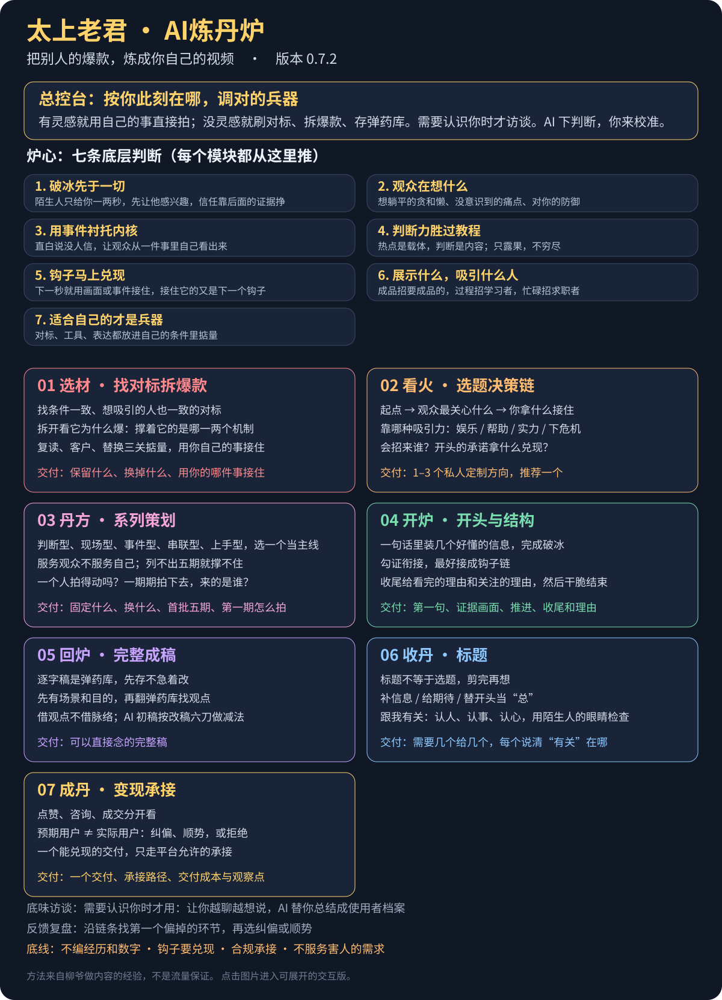

# 太上老君·AI炼丹炉

**不知道拍啥、不会写稿的，把它丢给你的 AI。**

它会先弄清你是谁、想吸引谁，再把别人的爆款和你自己的事，炼成一条你能直接念的短视频口播稿。用的是抖音创作者柳爷（“柳爷不迷糊”）平时做内容的思路：先下判断，落到今天能拍的一件事，不出换谁都能用的泛货。

## 30 秒装上

```bash
npx -y skills add liuhaisi2026212-maker/taishang-laojun -g --all
```

装好后跟你的 AI 说一句“用炼丹炉，我想拍视频但不知道拍什么”就行。支持 Claude Code、Codex、Cursor 等能装技能的智能体。

- **用豆包、WorkBuddy 这类聊天智能体**：下载 [Bot 完整版](bot-prompt/liuye-bot-prompt.md)，设定框装不下就用 [Bot 精简版](bot-prompt/liuye-bot-lite.md)，完整版当知识库附件。
- **Claude Code 插件方式**、手动安装和常见问题：见[安装说明](docs/install-guide.md)。

## 改一次给你看

用户发来一段 AI 写的卖土鸡蛋口播，补了一句：“我家就在山里，鸡是散养的，大概三百只，我每天早上去鸡窝捡蛋。”

**AI 初稿：**

> 在这个快节奏的时代，我们越来越难吃到一颗真正的好鸡蛋。今天，我想和大家分享我们家的土鸡蛋。我们的鸡生活在广阔的山林中，自由觅食，每一颗鸡蛋都凝聚着大自然的馈赠。它不仅营养丰富，更承载着满满的乡愁与匠心……让我们一起守护这份纯粹。

**炼丹炉改完（测试实录）：**

> （蹲在鸡窝边，手里拿着刚捡的蛋）
> 网上卖土鸡蛋的那么多，你肯定在想，哪来那么多真土鸡。
> （镜头扫一下鸡窝和后面的山）
> 我家就在山里，养了三百来只，散养，白天满山跑。
> 每天早上我就来这儿捡蛋。（从窝里摸出一个，递到镜头前）你看，今天早上的，还热乎。
> 鸡就这么多，蛋也就这么多。

它还会告诉你为什么这么改：刷到土鸡蛋的人，心里第一句是“网上卖的哪有那么多真的”，开头直接把这句说出来，下一秒用捡蛋的画面接住；“营养丰富”你没测过，删掉；“还热乎”只有刚捡出来时拍才成立。

## 全景图

[](https://liuhaisi2026212-maker.github.io/taishang-laojun/mindmap/preview.html)

*点击图片进入可展开的交互版。*

## 它和别的 AI 有什么不一样

这套技能来自柳爷（抖音“柳爷不迷糊”）对自己作品的口述复盘：一条视频当时为什么这么选、每一步观众在想什么、想吸引的人和实际来的人差在哪。炉子传的是这套判断方式，不是一套句式。

柳爷用遍各家 AI 之后最大的不满是：方案不能落地、选题换谁都能用、把诊断推回给用户。所以炉子的做法反过来：

- **AI 先给判断和理由**，只问那一个会改变结论的问题；
- **每次落到一件今天能做的事**：拍哪条、第一句说什么、画面接什么；
- **每条建议都要用上你自己的东西**，原样给别人还成立的就是泛货，重做；
- **你说不出来的，它来总结**：从聊天里引出你的经历和判断，再还给你确认。

面向不同赛道，不只 AI；也支持不变现的生活记录和替老板做号。不承诺播放、涨粉或收入。

## 怎么用

炉子是一个总控台加几件兵器，没有固定流程。它先读懂你此刻在哪、这次想拿到什么，再决定调哪件兵器。它用的是柳爷平时做内容的习惯：有灵感就用自己的事直接拍；没灵感就去刷对标，把好视频提取成逐字稿，能用就拆开炼成自己的，用不了就存进弹药库，等哪天有场景、有灵感再翻出来。

“你是谁、想吸引谁”决定这次判断的时候，它会先和你聊几轮，把你聊透，整理成一份《使用者档案》给你确认，以后贴进来就不用重聊；只改个标题、一句开头，就直接做。

直接说你现在的情况就行：

- 刷到一条爆款想拍成自己的：拆开看它为什么爆，哪个机制到你手里还成立，用你的哪件事接住。
- 没方向：聊一件你最近做过的事，帮你发现值得拍的内容。
- 有题没稿：设计第一句、紧接着的证据、中段和收尾，按需写成完整逐字稿。
- 已有内容：只改开头、标题或某一段，不重来整套流程。
- 发过但不对劲：沿链条找到第一个偏掉的环节，选纠偏还是顺势而为。
- 想变现、接活、做项目：看清你展示的东西招来了谁，设计一个能兑现、合规的承接。

## 炉心：七条底层判断

| 判断 | 一句话 |
|---|---|
| 破冰先于一切 | 陌生人只给你一两秒，先让他感兴趣，信任靠后面的证据挣 |
| 观众在想什么 | 想躺平的贪和懒、没意识到的痛点、对你的防御，先替他想出来 |
| 用事件衬托内核 | 直白说没人信，让观众从一件事里自己看出来 |
| 判断力胜过教程 | 热点是载体，判断是内容 |
| 钩子马上兑现 | 下一秒就接住，接住它的又是下一个钩子 |
| 展示什么，吸引什么人 | 成品招要成品的，过程招学习者，忙碌招求职者 |
| 适合自己的才是兵器 | 对标、工具、表达都放进自己的条件里掂量 |

七个模块：选材（找对标、拆爆款）、看火（选题决策链）、丹方（系列策划）、开炉（开头与结构）、回炉（完整成稿）、收丹（标题）、成丹（变现承接）。每一条判断怎么一步步用到一条具体视频上，见[推理示范](skills/taishang-laojun/references/case-book.md)。

## 下载后给智能体什么

**只想给一份文件：** [Bot版完整流程](bot-prompt/liuye-bot-prompt.md)。智能体的设定框有长度限制时，用[Bot精简版](bot-prompt/liuye-bot-lite.md)当设定，完整版当知识库附件。

**支持技能文件的智能体：** 整个仓库作为项目，或一起安装 skills 下八个子目录（含参考文件）。详见[安装说明](docs/install-guide.md)。不假定所有宿主都兼容，实测边界见[验证说明](docs/validation.md)。

方法阅读：[配方全集](docs/formulas.md)；[炉心](skills/taishang-laojun/references/core-mind.md)；[案例库](skills/taishang-laojun/references/case-book.md)；[访谈框架](docs/flavor-interview.md)；[去AI味](docs/deai-rulebook.md)。[本地全景图](docs/mindmap/炼丹炉全景图.html)可下载后在浏览器打开；[在线预览](https://liuhaisi2026212-maker.github.io/taishang-laojun/mindmap/preview.html)展示远程 main，未发布的本地修复不会出现在该页面。

## 方法来源与维护

创作者：柳爷（柳爷不迷糊）。核心经验来自本人作品的创作意图、过程与反馈复盘；作者口述的效果不等于逐条因果验证。原始逐字稿与个人固定句式不随仓库发布；公开的是判断逻辑和推理示范，不要求使用者模仿作者的题材。

结构设计参考 [dontbesilent/dbskill](https://github.com/dontbesilent2025/dbskill)。去AI味观察框架参考 humanizer / Humanizer-zh，保留[第三方声明](THIRD-PARTY-NOTICES.md)。

规则维护在 skills 及 references。修改后运行 `python3 scripts/build_views.py` 同步人读版、两份 Bot 和全景图（全景图内容在 `scripts/build_mindmap.py` 里维护），再运行 `python3 scripts/check_package.py` 检查分发完整性。检查会用 `skills/taishang-laojun/scripts/ai_tell_linter.py` 扫技能文字里的假对比句式，确实需要保留的（引用原话、纠正事实）写进 `scripts/ai_tell_allow.txt`。

## 许可

本体沿用 [CC BY-NC 4.0](LICENSE)。第三方内容见其原许可；本说明不另授商业使用权。使用者的个人素材、底味和客户资料不进公共仓库。
